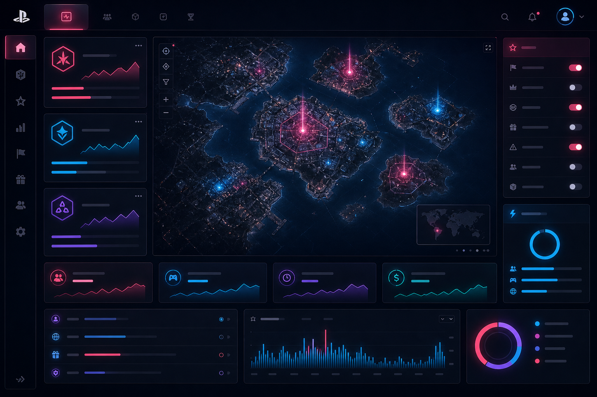
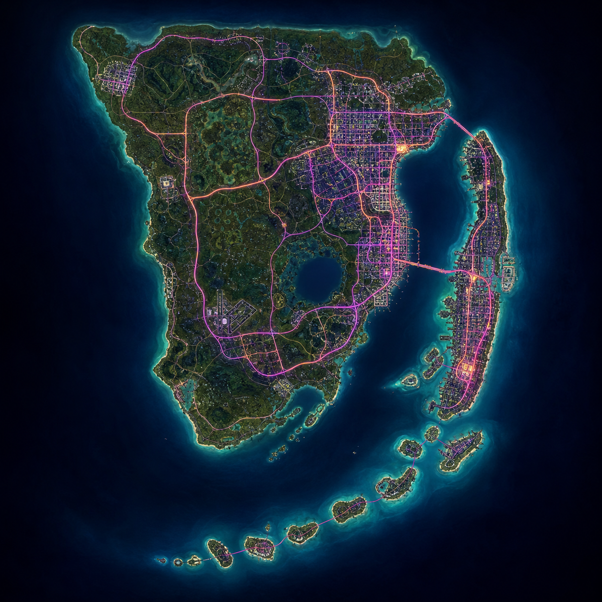

# 🌴 LEONIDA LIVE — GTA VI × Flagsmith Flag Command Center


**Flip a flag. Change Vice City. Instantly. No patch. No restart.**

> 🎬 **Demo video:** [`assets/demo.mp4`](assets/demo.mp4) (52s, HD + narration) — full script in [docs/VIDEO_SCRIPT.md](docs/VIDEO_SCRIPT.md).

A PS5-style live-ops dashboard for a fictional GTA VI Online, powered by
open-source [Flagsmith](https://www.flagsmith.com/). Every toggle is a real
feature flag — flip one and the game world (map, weather, wanted level, XP,
player count) updates live, across environments, with zero redeploy.

> Built for the Flagsmith track. Getting Flagsmith running was the start,
> not the project — this is the thing we wished existed while setting it up.

---

## 🏆 Why this wins

| Judge checklist | How LEONIDA LIVE nails it |
|---|---|
| **Real Flagsmith integration** | Official JS SDK (`flagsmith.init` + `onChange` + `hasFeature`), REST mock API, per-environment flags, audit log |
| **Wow in 30 seconds** | Flip `leonida_expansion` → new islands appear on the map. Flip `hurricane_ian` → rain. No refresh. |
| **PS5 + GTA VI theme** | DualSense-style UI (△ ○ ✕ □, D-pad + gamepad support), Vice City / Leonida Keys / Port Gellhorn lore |
| **One-command setup** | `docker compose up` or two stdlib Python commands. Zero `pip`/`npm` installs. |
| **Reusable by others** | Add a flag in 3 steps (see `docs/ARCHITECTURE.md`). MIT licensed. |
| **Never breaks live** | Mock API → local fallback. Works offline, in a preview iframe, anywhere. |

---

## 📸 Screenshots

| Before — expansion locked | After — flags flipped live |
|---|---|
|  |  |

> **Take real screenshots in 2 minutes:** run the app (`python3 -m http.server 3000`),
> open `http://localhost:3000`, screenshot (1) locked map, (2) after flipping
> `leonida_expansion` + `neon_nights_event`, (3) terminal running
> `python3 cli/leonida.py --list`. Save as `assets/shot-1.png` etc. and replace
> the images above — judges trust real captures over concept art.

---

## ▶ Quick start (pick one)

### Option A — Instant (no Docker, no installs)

```bash
# Terminal 1 — mock Flagsmith API (shared state)
python3 mock/server.py

# Terminal 2 — the app
python3 -m http.server 3000
# open http://localhost:3000
```

### Option B — Docker (app + mock API)

```bash
docker compose up
# open http://localhost:3000
```

### Option C — Real self-hosted Flagsmith

```bash
docker compose --profile real up   # genuine Flagsmith + Postgres on :8000
# open http://localhost:3000 → ⚙ Connect Flagsmith → paste API URL + env key
```

### Terminal dashboard (same flags, no browser)

```bash
python3 cli/leonida.py                 # interactive dashboard
python3 cli/leonida.py --list --env staging
python3 cli/leonida.py --toggle leonida_expansion --env production
python3 cli/leonida.py --events        # audit log
```

> Flip a flag in the terminal — the web dashboard updates in <2s. And vice versa.

---

## 🚩 The 10 flags (seed-flags.json)

| Flag | What it does in the world |
|---|---|
| `leonida_expansion` | Unlocks Leonida Keys + Port Gellhorn |
| `neon_nights_event` | Night falls, neon banner, event live |
| `hurricane_ian` | Rain + storm overlay |
| `double_xp_weekend` | XP multiplier ×2 |
| `ps5_beta_access` | 4K/120Hz beta, player count up |
| `police_pursuit_ai` | Police + helicopter, ★★★★★ wanted |
| `lowrider_culture_pack` | Ocean Drive car meet |
| `crossplay_enabled` | PS5 + Xbox + PC player count |
| `new_weapon_smg` | Weapon drop (no patch) |
| `traffic_density_high` | Rush-hour traffic AI |

Each flag has independent values for **Production / Staging / Dev** — switch
environments in the top bar and watch the world re-evaluate.

---

## 🎮 Controls

- **Mouse / touch** — click any toggle
- **Keyboard** — `↑` `↓` navigate, `Space` toggle, `1–9` quick-flip
- **DualSense** — D-pad navigates, `✕` (A) toggles (Gamepad API)
- **Search + category filter** — find flags fast

---

## 🧱 How it works

```
Web Dashboard ──┐
                ├──► Mock Flagsmith API (:8001) ──► state.json
Terminal CLI ───┘         (or Real Flagsmith :8000 via official SDK)
```

- **Mock API** (`mock/server.py`, stdlib only) mimics the Flagsmith REST
  surface: `GET /api/v1/flags/`, `POST /api/v1/flags/<name>/toggle`, events.
- **Web app** polls every 2s (like the SDK) and re-renders the SVG Vice City
  map + stats on change. Falls back to local state if the API is unreachable.
- **Real mode** loads the official Flagsmith JS SDK from CDN:
  `flagsmith.init({ environmentID, api, cacheFlags:true, onChange })`.

Full details: [docs/ARCHITECTURE.md](docs/ARCHITECTURE.md) ·
Demo script: [docs/DEMO.md](docs/DEMO.md)

---

## 🗺 Roadmap

- [x] Web dashboard + live Vice City map
- [x] Terminal dashboard (CLI)
- [x] Mock API + Docker one-command setup
- [x] Real Flagsmith SDK mode
- [ ] VS Code extension: live flag values inline (see `vscode-extension/`)
- [ ] Flagsmith admin-panel plugin: flip flags without code
- [ ] Starter templates (Next.js / Django) with flags included

---

## 📄 License

MIT — fork it, ship it, flip flags with it. 🌴
